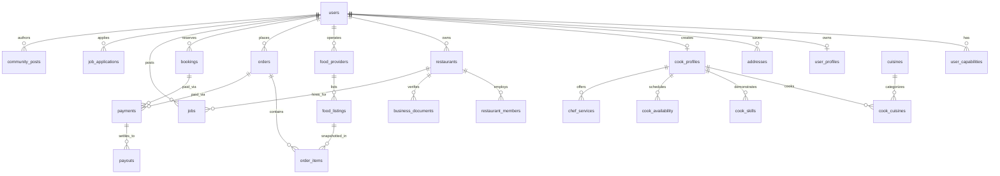

# DHANDHA — Complete Product Architecture & Engineering Blueprint

> **"Kaam bhi. Khana bhi."**  
> *India's Cooking Services Marketplace*  
> *Every Cook. Every Kitchen. Every Opportunity.*

---

## 1. Brand & Design System

DHANDHA is a unified marketplace for India connecting households, home cooks, professional executive chefs, restaurants, and cloud kitchens.

### Color Palette

- **Prussian Blue**: `#161B33` (Primary brand & dark surfaces)
- **Ink Black**: `#0D0C1D` (Deep backgrounds & luxury surfaces)
- **Almond Cream**: `#F1DAC4` / Lightest: `#FCF8F3` (Main app background)
- **Saffron**: `#F28C28` (Primary CTA accent), Hover: `#C96813`, Subtle: `#FFF0DF`
- **Dusty Grape**: `#474973` (Secondary accents & structure)
- **Lilac Ash**: `#A69CAC` (Muted labels & timestamps)
- **Success / Clear**: `#23865B` (FSSAI / Govt ID Verified)
- **Danger**: `#C94B4B`

### Typography

- **Headings**: Plus Jakarta Sans (`font-heading`)
- **Body**: Inter (`font-sans`)

---

## 2. Core Business Verticals

1. **Hire a Cook (Domestic / Household)**
   - Daily household cooks, part-time, full-time, hourly, one-time trial.
   - Filtering by city, locality, cuisine specialty (North Indian, South Indian, Gujarati, Jain, etc.), dietary preferences, experience, rates.
   - Household cook requirements can be posted freely by ordinary users.

2. **Hire a Chef / Book an Executive Chef**
   - Private dining multi-course tasting menus, house parties, weddings, and corporate banquets.
   - Guest capacity counter, custom menu consultation, and transparent package pricing.

3. **Restaurant and Commercial Kitchen Hiring**
   - Head chefs, tandoor specialists, biryani masters, and kitchen assistants.
   - Strict capability check: **Only verified business accounts with FSSAI & GSTIN documentation can post commercial jobs**.

4. **Homemade Food & Tiffin Marketplace**
   - Daily tiffins, traditional thalis, regional specialties, and breakfast combos.
   - FSSAI compliant home cook onboarding and item price snapshotting.

5. **Reddit-Style Cooking Community**
   - Upvotes, downvotes, threads, regional family recipes, cook salary transparency, and tips.

---

## 3. One Account — Multiple Capabilities

DHANDHA does not force users into permanent account silos. A single user can simultaneously order food, hire a home cook, work as a chef, and manage restaurant hiring through a dynamic capability system:

```text
ORDER_FOOD
BOOK_COOK
BOOK_CHEF
POST_GENERAL_JOB
APPLY_FOR_JOB
CREATE_COOK_PROFILE
POST_RESTAURANT_JOB
MANAGE_RESTAURANT
LIST_FOOD
MANAGE_FOOD_LISTING
MANAGE_ORDERS
ADMIN
```

---

## 4. Database Architecture (Entity Relationship Diagram)



---

## 5. Screen Directory (Next.js 16 App Router)

| Route | Purpose | Features |
|---|---|---|
| `/` | Flagship Marketplace Homepage | 3D Interactive Canvas, Category Grid, Featured Cooks, Food, Jobs, Community |
| `/explore` | District-Style Discovery | Unified Tabs (For You, Cooks, Chefs, Food, Jobs), Location Picker, Cuisines |
| `/cooks` | Cook Discovery & Filters | City selector, Cuisines, Experience, Rates, Verified filter |
| `/cooks/[id]` | Cook Profile Detail | Bio, Skills, Availability schedule, Verified reviews, Sticky booking widget |
| `/chefs` | Executive Chef Booking | Private dining, weddings, house parties, capacity filters |
| `/chefs/[id]` | Chef Service Experience | Guest counter, menu consultation, price calculation |
| `/food` | Food & Daily Tiffins | Pure Veg toggle, categories (Thali, Snacks, Biryani), order basket |
| `/food/[id]` | Dish Detail | Ingredients, FSSAI verification badge, portion multiplier, checkout |
| `/jobs` | Culinary Jobs & Hiring | Household cook needs vs commercial restaurant openings |
| `/jobs/[id]` | Job Detail | Salary, working hours, vacancies, quick application pitch modal |
| `/jobs/post` | Post Job / Requirement | Separation between Household free posting and Restaurant FSSAI verification |
| `/community` | Reddit-Style Community | Upvotes/downvotes, thread tags, new post modal, discussions |
| `/login` | Mobile OTP & Google OAuth | District-style phone number entry, OTP verification, Google auth |
| `/register` | 3-Step Universal Onboarding | Mobile signup, profile basics, capability & interest customization |
| `/dashboard` | Universal Customer Dashboard | Switch modes (Customer, Cook, Restaurant, Admin), bookings, activity |
| `/dashboard/cook` | Professional Mode Dashboard | Monthly earnings, booking requests, shift timetable, verification status |
| `/dashboard/restaurant` | Restaurant Management Hub | Active openings, applicant pipeline, FSSAI/GSTIN verification centre |
| `/dashboard/admin` | Admin Verification & Governance | Document review queue (Approve/Reject), configurable commission engine |
| `/dashboard/settings` | Settings & Addresses | Profile editing, encrypted address management, capability statuses |
| `/about` | About DHANDHA | Mission, safety standards, regional culinary diversity, contacts |
| `/terms` | Terms of Service | Indian marketplace regulations, capability-based compliance |
| `/privacy` | Privacy Policy | Encrypted coordinates & residential addresses, DPDP compliance |
| `/cancellation` | Refund & Cancellation | 3-day cook replacement guarantee, chef cancellation policy |

---

## 6. 3D Elements & Visual Innovation

The UI reserves dedicated, interactive 3D containers:
- **`ThreeDElement` component (`src/components/common/three-d-element.tsx`)**:
  - Interactive mouse perspective tilt with 3D layers.
  - HTML5 dynamic particle canvas simulating cooking flames and glowing embers.
  - Multi-layered 3D cooking glyph with rotating rings and floating orbital badges.
  - Seamlessly ready to accept any external Spline 3D URL or Three.js scene embed via `splineUrl` prop.

---

## 7. Quickstart & Local Setup

### Prerequisites
- Node.js 20+ & pnpm
- Docker & Docker Compose

### 1. Run with Docker Compose (Database, Redis & Services)
```bash
docker-compose up -d postgres redis
```
This automatically initializes the PostgreSQL database with `database/schema.sql` and `database/seed.sql`.

### 2. Run the Next.js Frontend
```bash
cd frontend
pnpm install
pnpm dev
```
Open [http://localhost:3000](http://localhost:3000) to view DHANDHA!

### 3. Build & Test Production Bundle
```bash
cd frontend
pnpm build
```
All 22 pages compile and prerender into optimized static and dynamic routes.

---

## 8. License

Proprietary © 2024 DHANDHA Technologies Pvt Ltd. All rights reserved.  
**Kaam bhi. Khana bhi.**
